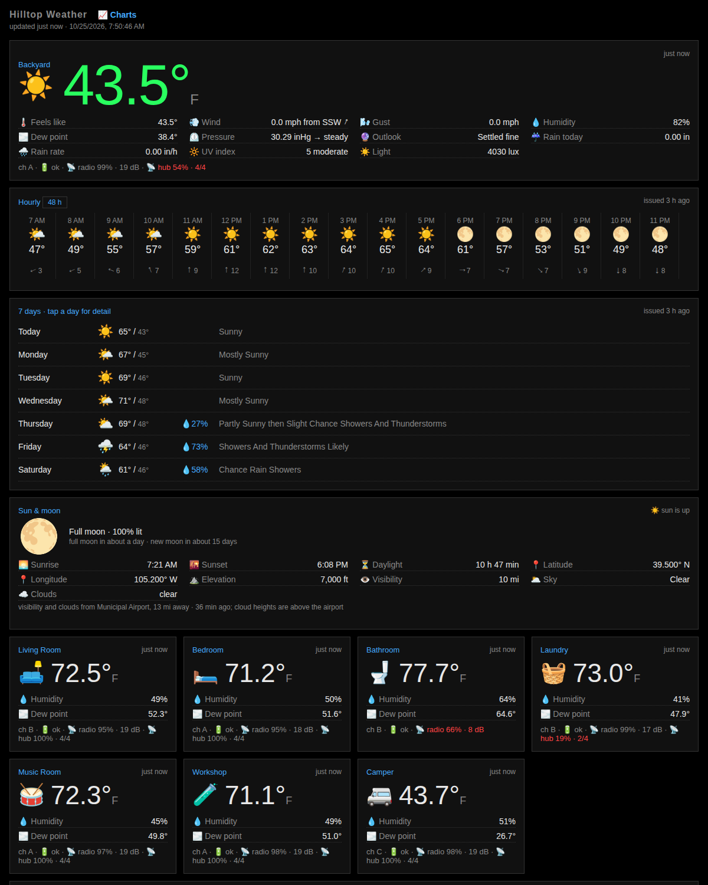
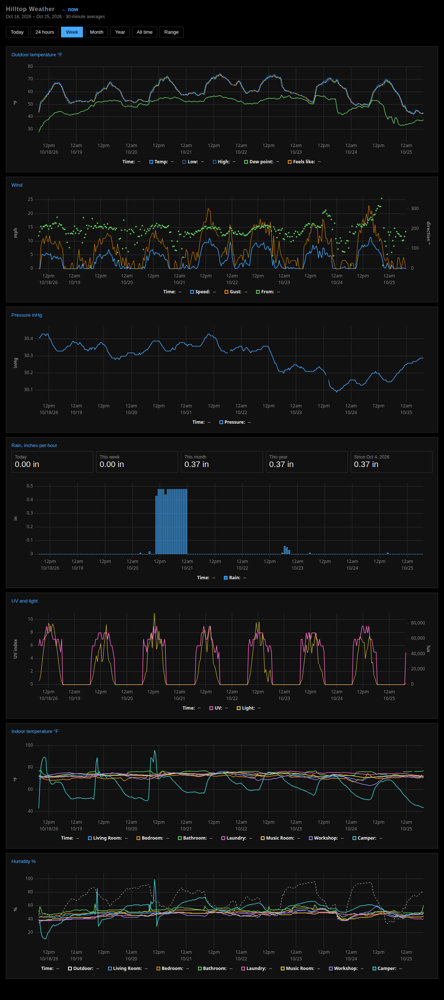
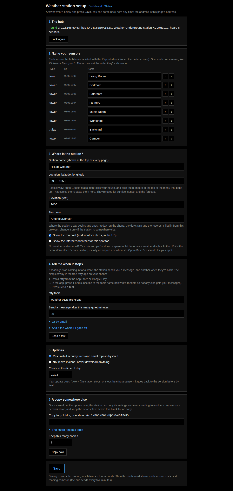
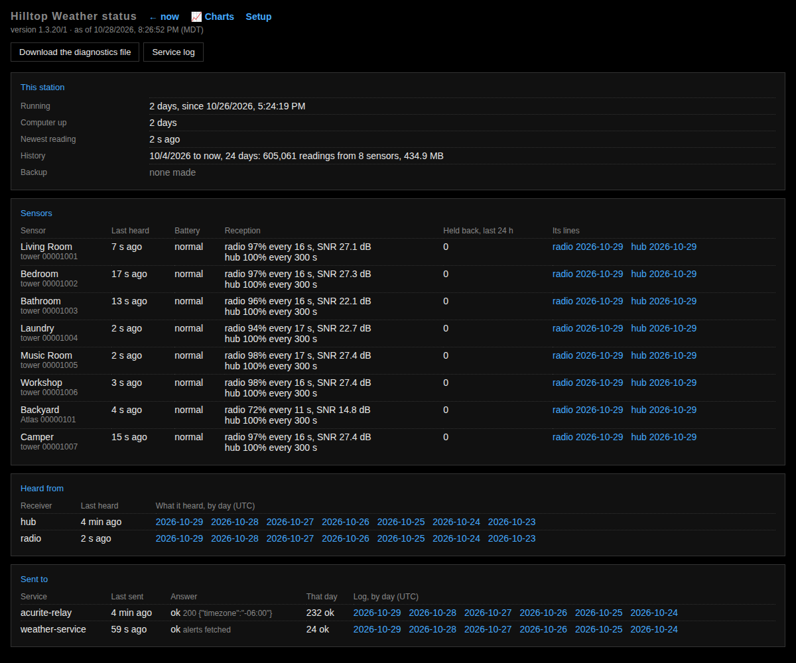
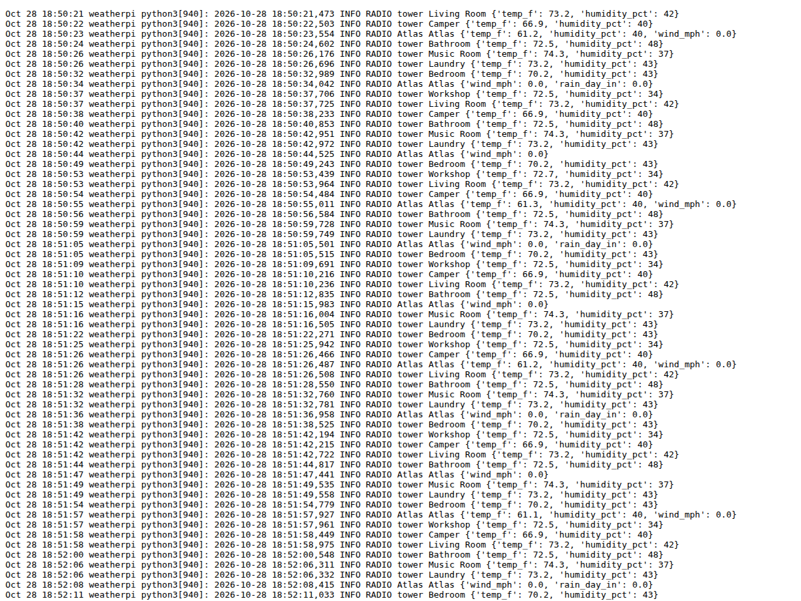
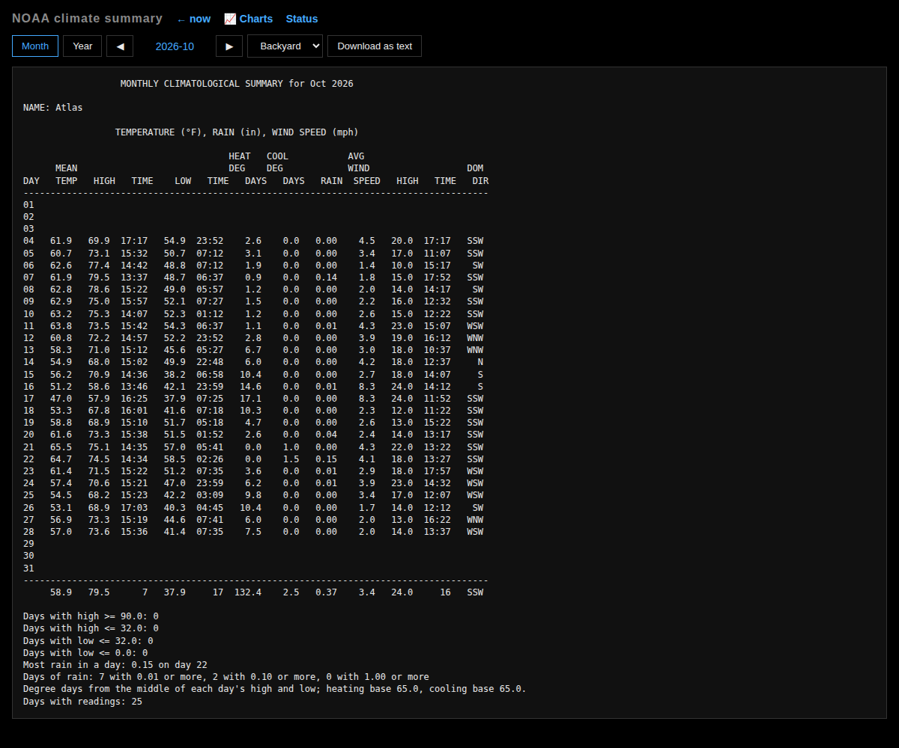
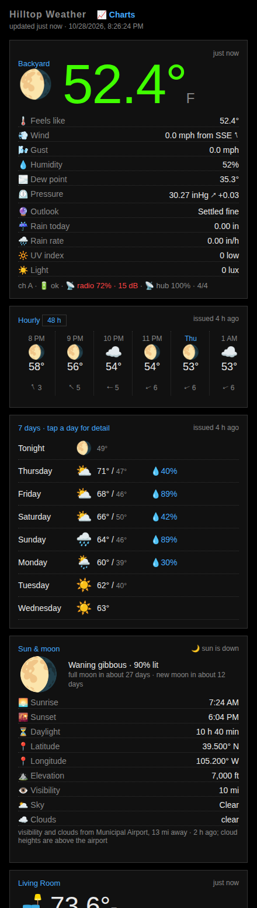
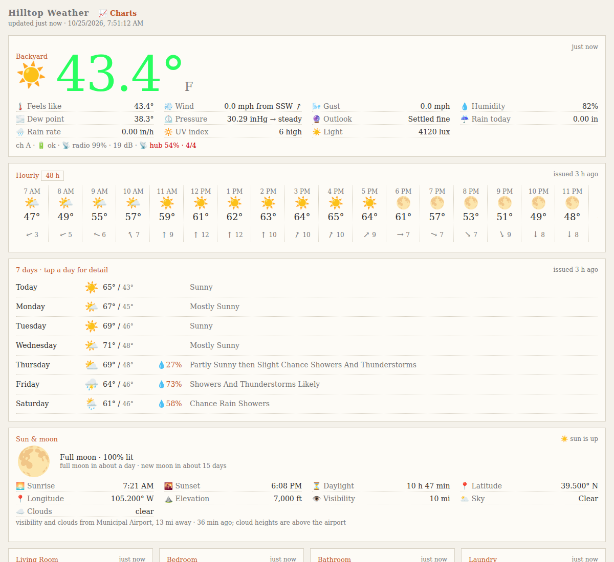

# CC0AC-Weather

**Contents:**
[What it's for](#what-its-for) ·
[Pictures](#pictures) ·
[What it does, alpha order](#what-it-does-alpha-order)

**Using it:**
[Install](#install) ·
[Other computers](#other-computers-one-command) ·
[The ready-made Pi card](#the-easy-way-a-ready-made-raspberry-pi-card) ·
[Looked after for you](#looked-after-for-you) ·
[Setup by hand](#setup-with-an-access-hub-by-hand) ·
[What it runs on](#what-it-runs-on-and-whats-been-tested) ·
[The dashboard](#the-dashboard) ·
[Charts](#charts) ·
[Records and normals](#records-and-normals) ·
[Barometer outlook](#barometer-outlook) ·
[In another page](#putting-the-dashboard-in-another-page) ·
[Settings in the browser](#settings-in-the-browser) ·
[The status page](#the-status-page) ·
[NOAA summaries](#noaa-climate-summaries) ·
[Sensors](#sensors-names-icons-and-links) ·
[Making it yours](#making-it-yours) ·
[Units](#units) ·
[Calibration](#calibration) ·
[Readings that can't be right](#readings-that-cant-be-right) ·
[MQTT and Home Assistant](#mqtt-and-home-assistant) ·
[Webhook and InfluxDB](#webhook-and-influxdb) ·
[AI assistants (MCP)](#asking-an-ai-assistant-mcp) ·
[Weather networks](#weather-networks) ·
[Weather alerts](#weather-alerts) ·
[Older readings](#bringing-in-older-readings) ·
[Theory of operation](#theory-of-operation) ·
[Radio capture](#radio-capture-no-hub) ·
[Other brands](#other-brands-consoles-no-radio) ·
[When something reads wrong](#when-something-reads-wrong) ·
[Wall displays](#wall-displays-old-android-phones-as-weather-kiosks) ·
[What leaves your house](#what-leaves-your-house) ·
[Seeing it from outside](#seeing-it-from-outside-your-house)

**Building on it:**
[Contributing and architecture](#contributing-and-architecture) ·
[Files](#files) ·
[Credits, the name, and the license](#credits-the-name-and-the-license)

## What it's for

Keep your AcuRite weather station working on your own terms: your own
dashboard, your own data files, Weather Underground uploads unchanged, and no
dependence on AcuRite's cloud. Built by Claude Code ("cc0") with Akien
MacIain; contributions welcome.

To be clear there are two other excellent choices for this right now. We each do things a little differently:
- https://github.com/acuparse/acuparse
- https://github.com/volneydouglas/zasder-weather-backend

## Pictures

Real readings, with a made-up station name, room names and location.

<table>
<tr>
<td width="50%"><a href="reddit_announcement/dashboard.png"></a><br><b>The dashboard</b></td>
<td width="50%"><a href="reddit_announcement/charts.png"></a><br><b>Charts</b>, one week</td>
</tr>
<tr>
<td><a href="reddit_announcement/setup.png"></a><br><b>Setup</b>: the whole of it</td>
<td><a href="reddit_announcement/status.png"></a><br><b>Status</b>: batteries, reception, where it sends</td>
</tr>
<tr>
<td><a href="reddit_announcement/log.png"></a><br><b>Logs</b>: the service log, from the status page</td>
<td><a href="reddit_announcement/noaa.png"></a><br><b>NOAA climate summary</b>, one month</td>
</tr>
<tr>
<td><a href="reddit_announcement/phone.png"></a><br><b>On a phone</b></td>
<td><a href="reddit_announcement/custom-theme.png"></a><br><b>Your own look</b>: one <code>theme.css</code></td>
</tr>
</table>

**Which stations and services it can work with:** [SUPPORTED.md](SUPPORTED.md)
lists every station, sensor, console and service it knows how to talk to,
AcuRite and other brands (Ambient Weather, Ecowitt, Fine Offset and its
relabels, Bresser, La Crosse, and more), by console upload or by radio, and
says how sure we are of each. Only AcuRite is tested on real hardware so far.

Not affiliated with or endorsed by AcuRite or Chaney Instrument Co. AcuRite is
their trademark; it is used here only to say which hardware this works with.

## What it does

### UI & Weather Display
- Alerts in the UI
- Alerts: Disk errors (disk health checked daily)
- Alerts: Low Batt & Signal
- Alerts: Weather Alerts (NWS)
- Alerts/Notifications: Email and nfty weather alarts incl frost, heat, falling barometer, etc.
- Data: Barometric forcasting in the output (works even offline)
- Data: Climate summary for month or year
- Data: Evapotranspiration
- Data: Lightning (Still calibrating)
- Pages: Charts
- Pages: Config (only available on your local network)
- Pages: Dashboard (main page)
- Pages: Raw Logs (only available on your local network)
- Pages: Setup Page (only available on your local network)
- Pages: Status page - most recent readings, links to logs, etc. (only available on your local network)
- User: Configurable UI (settings names and icons for sensors, reporting order, etc)
- User: User specificed unit types & time zone
- System: Http/s outout (defaults to port# 12345)
- Web interface designed for phones and desktops

### Hardware: Computers, Radios, and Sensors
- Computers: Linux, MacOs, Raspian, Windows
- Computer: Automatic backups (defaults to weekly)
- Computer: Automatic Updates (optional)
- Docker (Windows and Linux)
- Radios: AcuRite Access, Atlas, and temp/humidity sensors: Fully Supported
- Radios: RTL-SDR V4
- Radios: All other brands of weather stations broadcast on the same band. We built support for them, and tested them in simulation (data is available on the web) but can't run final checks on their hardware ourselves.
- Sensors: Calibration adjustments for sensors that are slightly off
- Sensors: Tested with AcuRite, All other brands of weather stations broadcast on the same band. We built support for them, and tested them in simulation (data is available on the web) but can't run final checks on their hardware ourselves.
- System service support for all the platforms I could test (Linux, Windows, MacOS)

### Services
- Acurite reporting (to their servers) supported (and optional)
- Cumulus support (weather db)
- CWOP support
- Influx DB
- MCP support for agenic inquiries
- MQTT support
- NWS or Open-Meteo Only operation for those with no sensors
- PS Weather support
- Webhook
- WeatherCloud support
- Weahter Underground support
- WeeWX support
- Windy support

### Misc
- Install made easy! https://github.com/akienm/CC0AC-Weather#install
- Home Assistant support (untested)
- Android 'side load' weather kiosk app
- Diagnostics file to help resolve issues
- Weather Records kept for as long as you want. Including NWS.


## Install

- **Easiest:** a ready-made Raspberry Pi card, [below](#the-easy-way-a-ready-made-raspberry-pi-card).
- **Any other computer:** [one command](#other-computers-one-command).
- **By hand,** if you want to know every step: [Setup with an Access hub, by hand](#setup-with-an-access-hub-by-hand).

## Other computers: one command

Every installer below sets up the same program and then hands it to a small
boot loader that starts it and keeps it patched
([UPDATES.md](UPDATES.md)). Each is safe to run again. When it finishes it
prints an address: open it and answer the setup page.

| Computer | Run this | Notes |
|---|---|---|
| **A Pi already running Raspberry Pi OS** | `curl -fsSL https://raw.githubusercontent.com/akienm/CC0AC-Weather/main/setup/install.sh \| sudo bash` | Takes over the Pi's network port for the hub, unless the Pi itself is plugged into your router there (`--no-hub-network` to be sure) |
| **Debian or Ubuntu** (an old laptop works well) | the same line | Lists the wired ports your network isn't on and asks which one the hub's cable goes into; Enter for none. Stops if no other port reaches the internet. Without a terminal to ask: `--hub-network PORT` |
| **Mac** | the same line **without** `sudo` | Needs Python 3 from python.org or Homebrew; runs while you're logged in. Untested: no Mac to test on |
| **Windows 10/11** | in PowerShell: `irm https://raw.githubusercontent.com/akienm/CC0AC-Weather/main/setup/install.ps1 \| iex` | Installs Python if it's missing; starts when you log on. Untested |
| **Docker** (anything) | `cd setup/docker && docker compose up -d` in a copy of this project | Readings and settings in the volume `cc0ac-weather-data`. Tested to the setup page on Docker Desktop, Windows 11; not yet with a hub |

Only a Pi or a Debian machine with a spare wired port can take the hub's
cable. A laptop usually has one network port, and it's the one it reaches your
network by; a USB network adapter adds a second, for the hub. The adapter's
port has a name like `enx00e04c680001` (`ip -br link` lists them), and the
installer offers it by that name. A laptop's own screen and keyboard then serve
as the station's console, and its battery rides out a power cut. Everything else uses the radio dongle, a console upload from another
brand, or the **internet's weather** (no station at all: `[online]` in the
settings, see [UPDATES.md](UPDATES.md)).

From a copy of the project, add `--source .` (Windows: `-Source .`) to install
that copy instead of downloading the newest release. The old
`setup/install-pi.sh` still works and runs `install.sh`.

## The easy way: a ready-made Raspberry Pi card

No programming and no router settings. You put a ready-made card in a
Raspberry Pi, plug the hub's network cable into the Pi instead of your router,
and answer one page in your web browser. The Pi then sits between the hub and
the internet: it keeps every reading and passes each one on, so the AcuRite app
and Weather Underground carry on as before.

**You need:**

- A Raspberry Pi with **both** a network port and Wi-Fi: Pi 3 B+, Pi 4, Pi 400
  or Pi 5 (not a Pi Zero, which has no network port). Its power supply.
- A microSD card, 16 GB or more (it gets erased).
- A computer to write the card from, and your Wi-Fi name and password.
- Your AcuRite Access hub and its network cable.

**Steps:**

1. Download `cc0ac-weather-<date>.img.xz` from this project's
   [Releases page](https://github.com/akienm/CC0AC-Weather/releases/latest).
2. Install **Raspberry Pi Imager** from <https://www.raspberrypi.com/software/>
   and open it.
3. *Choose Device*: your Pi. *Choose OS*: scroll to the bottom, **Use custom**,
   and pick the file you downloaded. *Choose Storage*: the microSD card.
4. Press **Next**. When it asks about OS customisation, choose **Edit settings**:
   - Make up a username and password (you'll rarely need them).
   - Tick *Configure wireless LAN*: your Wi-Fi name, password and country.
   - Set your time zone.
   - Leave the hostname as it is (`cc0ac-weather`).

   Save, then **Yes** to write the card. It takes a few minutes.
5. Put the card in the Pi. Unplug the hub's cable from your router and plug it
   into the Pi's network port. Power the Pi on.
6. Wait about five minutes (the first start is the slowest), then on a computer
   or phone on your Wi-Fi open **<http://cc0ac-weather.local/>**. The setup
   page finds the hub and lists your sensors. Name them, paste in your
   location, set up a phone alert if you like, and press **Save**.

That's it: the dashboard is at the same address, and the charts are linked from it.

## Troubleshooting

**If <http://cc0ac-weather.local/> doesn't open:** some Android phones and
older Windows PCs don't understand `.local` names. Look in your router's list
of connected devices for `cc0ac-weather` and open its address instead (for
example `http://192.168.1.37/`).

**If something goes wrong,** plug the hub's cable back into your router. The
hub works exactly as before; nothing on it was changed.

**Phone alerts.** The setup page can send a message to your phone (through the
free ntfy app) or an email when readings stop, and another when they're back.
To hear about the Pi itself losing power, add a free healthchecks.io check on
the same page.
It can also warn about the weather itself: frost, heat, a falling barometer
and lightning close by (see [Weather alerts](#weather-alerts)).

## Looked after for you

- **Updates.** Setup asks one question: install security fixes and small
  repairs by itself, or leave it alone. Each new version is tried and rolled
  back if it doesn't work. [UPDATES.md](UPDATES.md) has the details.
- **Disks.** Once a day it asks each disk about its own health (SMART) and
  says so on the dashboard, and by phone alert, when one is failing.
- **Backup.** Once a week, if you name a folder or a Windows share
  (`\\server\share\folder`) in setup, it copies the settings and every reading
  there and keeps the newest 8.

**Want a helper?** If you use Claude Code or another AI coding assistant on the
Pi, point it at [SETUP-FOR-CLAUDE.md](SETUP-FOR-CLAUDE.md).

To build the card image yourself: `sudo setup/build-image.sh` on a 64-bit Pi.

## Setup with an Access hub, by hand

There are two ways to get the hub's readings to this program. Install the
program first; it is the same for both.

| | **A. Change the hub's server name** | **B. Plug the hub into the Pi** |
|---|---|---|
| Hardware | Any Linux box that stays on | A Raspberry Pi (or any Linux box) with a spare Ethernet port, on Wi-Fi |
| Hub settings | Changed to name your box | Left exactly as they came |
| Router | Forward port 443 to your box | Nothing (optionally a port for the dashboard) |
| If your box is down | The hub keeps uploading to Weather Underground; AcuRite's app stops | The hub is offline: no AcuRite, no Weather Underground |
| Setup effort | Five minutes | About half an hour |

**A** is the quick one. **B** is what the author runs: the hub never knows
anything changed, a factory reset of the hub doesn't undo it, and nothing on
the internet can reach the hub.

### Install the program

You need: Python 3.8+ and openssl (both come with Raspberry Pi OS).

```bash
git clone https://github.com/akienm/CC0AC-Weather ~/dev/src/CC0AC-Weather
mkdir -p ~/.cc0ac-weather
cp ~/dev/src/CC0AC-Weather/config.ini.example ~/.cc0ac-weather/config.ini
```

Edit `~/.cc0ac-weather/config.ini`: `write_path`, a section per sensor, named by
its ID, with its `title` (see [Sensors: names, icons and links](#sensors-names-icons-and-links)), `hub_id` under `[hub]` (the hub's MAC, from its local web page),
and `[web] enabled = true`. Settings that a later update brings are added to the
end of this file at their defaults (every upload off), so it always lists every
option there is. Then install the service:

```bash
sudo cp ~/dev/src/CC0AC-Weather/cc0ac-weather@.service /etc/systemd/system/
sudo systemctl enable --now cc0ac-weather@$USER
```

Find the hub's address on your router's client list (it shows up as
`W550-…` or similar) and open `http://HUB_IP/` in a browser. That page lists
the hub's ID (its MAC), every sensor ID it hears, and its current settings.

### A. Change the hub's server name

You also need a router that can forward port 443.

1. **Give the hub a hostname that reaches this box.** The hub accepts only a
   name, not an IP address. If your router can't serve local names, use your
   public hostname (your ISP's reverse-DNS name, or a free dynamic DNS name)
   and forward **port 443** on the router to this box.
2. **Change the hub's server setting.** Its web form is read-only in a
   browser, but the hub accepts a direct POST. Send *all five* fields, or its
   Weather Underground settings are blanked (read the current values from the
   hub's page first):

   ```bash
   curl -d 'ser=YOUR.HOST.NAME&id=WU_STATION_ID&ps=WU_PASSWORD&dev1=ATLAS_ID&ele=ELEVATION' \
        http://HUB_IP/config.cgi
   ```

   To undo, send the same with `ser=atlasapi.myacurite.com`.
3. Watch `journalctl -u cc0ac-weather@$USER -f`: within 5 minutes a line per
   sensor appears, and every raw request is kept in `~/.cc0ac-weather/hub-raw/`.

### B. Plug the hub into the Pi

The hub's Ethernet cable goes into the Pi instead of your router, and the Pi
reaches your network over Wi-Fi. A laptop or PC works the same way with a
second wired port (a USB network adapter): below, read `eth0` as the hub's port
and `wlan0` as the one your network is on, whatever `ip -br link` calls them.
The installer does all of this by itself (`--hub-network PORT`). The Pi then plays router for the hub. It gives
the hub an address, and when the hub asks where `atlasapi.myacurite.com` is,
the Pi answers "here". Every other name the hub looks up gets the real answer,
so its Weather Underground uploads (and its clock) pass straight through the
Pi to the internet. The hub's settings never change.

    sensors ──radio──▶ hub ──cable──▶ Pi eth0 (192.168.77.1)
                                       ├─ "atlasapi.myacurite.com" → this program → AcuRite
                                       └─ everything else (Weather Underground) → Wi-Fi → internet

Commands below are for Raspberry Pi OS (Debian 12/13, NetworkManager). The
example uses a private network, `192.168.77.0/24`, that is unlikely to clash
with yours; any private range works.

1. **Get the Pi on Wi-Fi first** (Raspberry Pi Imager can set it up), and
   install the program as above. Set `hub_id` in `config.ini`.

2. **Give the cable port a fixed address, and keep it from becoming the
   Pi's way to the internet:**

   ```bash
   sudo nmcli con add type ethernet ifname eth0 con-name hub \
        ipv4.method manual ipv4.addresses 192.168.77.1/24 \
        ipv4.never-default yes ipv6.method disabled
   ```

3. **Hand the hub an address, and answer AcuRite's name with the Pi.**
   `sudo apt install dnsmasq`, then `/etc/dnsmasq.d/cc0ac-hub.conf`:

   ```ini
   # DHCP and DNS for the hub, on the cable port only.
   interface=eth0
   except-interface=lo
   bind-interfaces
   dhcp-range=192.168.77.50,192.168.77.99,12h
   dhcp-option=option:router,192.168.77.1
   dhcp-option=option:dns-server,192.168.77.1
   # The hub's server name answers with this Pi; every other name passes through.
   address=/atlasapi.myacurite.com/192.168.77.1
   ```

   `sudo systemctl restart dnsmasq`. dnsmasq serves the cable port only. The
   Pi itself still asks your router for names, so when this program relays to
   AcuRite it reaches the real server, not itself.

4. **Let the hub out through the Pi.** Turn on forwarding:

   ```bash
   echo net.ipv4.ip_forward=1 | sudo tee /etc/sysctl.d/90-cc0ac-forward.conf
   sudo sysctl --system
   ```

   Then replace `/etc/nftables.conf` with this (it also closes the Pi to
   everything except what's listed), and `sudo systemctl enable --now nftables`:

   ```
   #!/usr/sbin/nft -f
   # wlan0 = your network. eth0 = the hub's cable (192.168.77.0/24).
   flush ruleset

   table inet cc0ac {
       chain input {
           type filter hook input priority filter; policy drop;
           iif lo accept
           ct state established,related accept
           ct state invalid drop
           meta l4proto { icmp, ipv6-icmp } accept
           tcp dport 22 accept comment "ssh"
           udp dport { 68, 546 } accept comment "the Pi's own DHCP replies"
           iifname "wlan0" tcp dport 12345 accept comment "dashboard"
           iifname "wlan0" udp dport 5353 accept comment "mDNS: yourpi.local"
           iifname "eth0" tcp dport 443 accept comment "the hub's uploads"
           iifname "eth0" udp dport { 53, 67 } accept comment "the hub's DNS and DHCP"
           iifname "eth0" tcp dport 53 accept
       }
       chain forward {
           type filter hook forward priority filter; policy drop;
           ct state established,related accept
           iifname "eth0" oifname "wlan0" meta nfproto ipv4 accept comment "the hub out to the internet"
       }
   }

   table ip cc0ac_nat {
       chain prerouting {
           type nat hook prerouting priority dstnat;
           # The hub sometimes ignores the DNS server DHCP gave it and asks 8.8.8.8,
           # then uploads straight to AcuRite. These send its DNS and its uploads
           # to the Pi whatever server or address it picked.
           iifname "eth0" udp dport 53 dnat to 192.168.77.1
           iifname "eth0" tcp dport 53 dnat to 192.168.77.1
           iifname "eth0" tcp dport 443 dnat to 192.168.77.1
       }
       chain postrouting {
           type nat hook postrouting priority srcnat;
           oifname "wlan0" masquerade
       }
   }
   ```

   Keep the `tcp dport 22` line or you lock yourself out of ssh.

5. **Move the cable.** Unplug the hub from your router and plug it into the
   Pi. If you had used method A before, put the hub's server name back to
   `atlasapi.myacurite.com` (all five fields, as in A step 2). Then check:

   ```bash
   journalctl -u dnsmasq -f            # the hub asks for and gets an address
   journalctl -u cc0ac-weather@$USER -f  # a line per sensor within 5 minutes
   ```

   The hub's own page is now at `http://192.168.77.5x/` from the Pi only
   (`curl` it there, or use an ssh tunnel). To undo everything, plug the hub
   back into your router.

To see the dashboard from outside your house, forward one port on your router
(for example 12345) to the Pi's Wi-Fi address, nothing else.

### If Weather Underground stops

The hub uploads to Weather Underground itself, over plain HTTP, whichever
method you use; this program never touches it. If wunderground.com stops
showing new readings while the dashboard is fine, the usual cause is the
password: it must be the **station key** shown under My Devices on
wunderground.com, not your account password (and not an older key from a
previous signup). A wrong key gets `401 unauthorized` back every few seconds.
Test a key without sending any data:

```bash
curl 'https://rtupdate.wunderground.com/weatherstation/updateweatherstation.php?ID=YOUR_STATION&PASSWORD=YOUR_KEY&dateutc=now&action=updateraw'
```

`success` means the key is right; then set it on the hub (all five fields, as
in A step 2, with `ser=atlasapi.myacurite.com` if you use method B).

### Things learned the hard way

Measured on firmware 051: the hub uses TLS 1.0/1.1 and
doesn't check the certificate (a self-signed one is generated for you); it
sends POST with everything in the query string; AcuRite rejects relayed
readings unless the hub's own `Atlas/<fw>` User-Agent is passed along; and
if the hub gets an error back it resends the same reading forever, so refusals
are answered locally.

## What it runs on, and what's been tested

"Tested" here means run, not read: something happened and we watched it.

| | Tested | Written, not yet tested |
|---|---|---|
| **Station** | AcuRite Access hub with an Atlas and indoor towers, in a house every day since 4 October 2026 | smartHUB; the 5-in-1, Iris and other AcuRite sensors |
| **Radio (no hub)** | RTL-SDR Blog V4 dongle hearing AcuRite sensors, live; 13 other models from recorded radio | the rest of [SUPPORTED.md](SUPPORTED.md) |
| **Other brands' consoles** | — | Ambient Weather, Ecowitt and Wunderground-format uploads |
| **No station** | the test suite only | the National Weather Service (US) or Open-Meteo (anywhere) as the only source: `[online]`, see [UPDATES.md](UPDATES.md#internet-weather-a-station-with-no-station) |
| **Computer** | Raspberry Pi 400, Raspberry Pi OS (Debian 13); an Ubuntu laptop | other Pis (3 B+, 4, 5), Mac, Windows, Docker |
| **Installing** | the boot loader's install, update and roll-back, in a test folder; Docker's first start on Windows 11 | the card image and the installers end to end on a fresh machine |
| **Wall kiosk** | an Android 14 emulator | a real phone |
| **Weather networks** | — | Windy, PWSweather, Weathercloud, CWOP with real accounts |
| **MCP** | a test client over the network | Claude Desktop through `mcp-remote` |

[SUPPORTED.md](SUPPORTED.md) has every brand and model, and how sure we are of each.

### The dashboard

`http://THIS_BOX:12345/` (port set by `[web] port`; several comma-separated
ports allowed). To share it, forward that port on your router. Visitors from
outside your network get the dashboard and the charts and nothing else (see
[Settings in the browser](#settings-in-the-browser)). The
`[buttons]` section puts a row of buttons in a pane at the bottom, each loading
a page that allows framing (a radar map such as Weather Underground's WunderMap,
a forecast, a webcam): `buttonN = Label | URL`. Blank buttons are not shown, and
with none set there is no pane. The page remembers which button you chose. To
log in to a site inside the pane, allow third-party cookies for the dashboard's
address in your browser. Or add a third part, `Label | URL | Target=wu`, and the
button opens its page in a browser window of that name instead, where logging
in works as usual; pressing it again reuses that window. `Target=_blank` opens
a new tab every time.

**The pictures are emoji.** Every icon on the dashboard (sky, moon phase, wind,
the buttons) is an emoji character, not an image, so it looks like whatever
your phone, tablet or computer draws for that emoji. The same page looks a bit
different on an iPhone, an Android phone and Windows, and a very old device may
show an empty box where its fonts have no such emoji.

Set `[station] latitude` and `longitude` (and optionally `elevation_ft`) and a
Sun & moon card appears: sunrise, sunset, daylight and the moon phase, computed
in the page with no outside service. The outdoor card shows everything the
Atlas sends (feels-like, dew point, wind with direction arrow, gusts, rain, UV
with its level, light, lightning) plus the 3-hour pressure trend. Lightning
is the strikes since midnight, counted from the sensor's running total and the
time of its last strike. One Access hub's total went from 0 to 256 for a
single strike, so a rise of a whole number of 256s counts as that many strikes;
that rests on one strike so far.

In the US, set `[forecast] enabled = true` (with `[station]` latitude and
longitude) and the program also fetches from the National Weather Service
(api.weather.gov, free, no key): an hourly strip for the next 24 hours (48 on
request) with sky, temperature, rain chance and wind; a 7-day list (tap a day
for the full forecast); visibility and cloud layers from the nearest airport on
the Sun & moon card; and a banner while any alert is active. Forecasts refresh
hourly, the airport every 20 minutes, alerts every 10. A failed fetch keeps
the last good copy and says so on the page.

### Charts

`📈 Charts` on the dashboard opens `charts.html`: every reading from
`weather.db` on one page — outdoor temperature (with dew point, feels-like and
the low–high band), wind speed, gusts and direction, pressure, rain, UV and
light, and temperature and humidity for every room. One row of buttons sets the
period for all of them: Today, 24 hours (this time yesterday to now), Week,
Month, Year, All time, or a Range of dates. Today starts at the station's
midnight: set `[station] timezone` (the setup page fills it in) when the
computer's clock isn't the station's, as in Docker, whose clock is UTC.
The period sits in the address (`charts.html#week`), so a view can be
bookmarked. Rain also shows totals for today, this week, month and year, and
since recording began.

The page asks `/history.json?period=week` (or `?from=YYYY-MM-DD&to=YYYY-MM-DD`)
and the server averages the readings into a few hundred points for whatever
the period is: 5-minute averages for a day, daily ones across years. The charts
use [uPlot](https://github.com/leeoniya/uPlot), loaded from jsDelivr.

### Records and normals

A Records card on the dashboard sets today against normal: the high and low
beside the 1991-2020 normals for the date, and the month's rain so far beside
the normal month-to-date. Below that come the station's records for this month,
this year and all time: hottest, coldest, highest gust, wettest day and the
pressure range, each with its date. Records count from the station's first
reading here, or from older readings brought in with `--import` (see
[Bringing in older readings](#bringing-in-older-readings)), and the card says
since when.

The normals need `[station] latitude` and `longitude`. In the US they are
NOAA's official 1991-2020 daily normals from the nearest weather station within
35 miles that has them (the card names it). Elsewhere, or with no such
station, they are averages of Open-Meteo's history for the exact spot over the
same 30 years. They are fetched once, kept in `normals.json` and refreshed
twice a year; `[climate] normals = false` keeps records only and fetches
nothing. Everything is rewritten hourly to `climate.json` and `climate.js`.

The same card counts **degree days** and **evapotranspiration**, both worked
out from each day's high and low, so no extra sensor is needed:

- Heating degree days measure how far a day's middle temperature (halfway
  between its high and low) is below `[climate] heating_base_f`, and cooling
  degree days how far it is above `cooling_base_f`. Both bases are 65°F unless
  you change them. The card shows this month and the season so far, and leaves off a season with none yet. The
  heating season runs from July 1 and the cooling season from January 1, as the
  Weather Service counts them; south of the equator the two swap. Heating
  degree days track the heating bill, and cooling degree days the air
  conditioning. The NOAA summaries count them the same way.
- **ET0** (reference evapotranspiration) is how much water a well-watered lawn
  gives up in a day, the usual guide to how much to water. Rain minus ET0 is
  roughly what the garden is short. It is worked out from the temperatures and
  `[station] latitude` by Hargreaves and Samani's formula (FAO Irrigation Paper
  56, equation 52). That formula is a little rougher than the full
  Penman-Monteith, which needs sunshine readings the sensors don't take well.
  The card shows it in your rain units, for today so far and this month. With
  no latitude it is left off.

*Status: measured 2026-10-24. The sun's energy matches FAO-56's worked example
8, and a day's ET0 matches equation 52 worked by hand. On one station over 20
October days, it came to 2.30 in against 3.21 in from Open-Meteo's
Penman-Monteith ET0 for the same spot. The full Penman-Monteith, worked from
the station's own humidity and wind, gave 2.28 in, so the formula is not the
gap. The likely causes are the yard's lighter wind (1-4 mph most days) and the
model's own sunshine. Read it as this yard's figure, a little below an open
field's. Not yet compared with an agricultural weather station's published ET0.*

### Barometer outlook

The outdoor card has an **Outlook** row: a short forecast such as "Fine,
becoming less settled" worked out on the spot, with no internet, from the
barometer, its 3-hour trend, the wind direction and the season. This is the
Zambretti forecaster, a dial for barometers from the 1910s. It is roughly
right three times in four for the next 12 hours, and it is often less right
than a real forecast. It appears once there are 3 hours of pressure readings,
and south of the equator it reverses the wind and the seasons.

### Putting the dashboard in another page

`weather.html?embed` is the dashboard without the button pane and the charts
link, made to sit in an `<iframe>` on another page: a home page, a Home
Assistant dashboard (its Webpage card), a family wiki. Add `&panes=` to show
only some cards, from `outdoor`, `hourly`, `daily`, `sky`, `rooms` and
`climate`:

```html
<iframe src="http://THIS_BOX:12345/weather.html?embed&panes=outdoor,climate"
        width="420" height="640" style="border:0"></iframe>
```

A page on the internet can frame it only through your router's port forward
(see [The dashboard](#the-dashboard)), and then anyone can see what the
dashboard shows, room temperatures included; `panes=` hides cards, it does not
keep their readings private.

### Settings in the browser

`http://THIS_BOX:12345/config.cgi` shows config.ini in one large pane, with
Save and Revert. Save checks the text still reads as an ini file (a missing
section header, a repeated section or option, or a broken `%(name)s` is refused
with the line it's on), keeps the old file as `config.ini.previous`, writes the
new one and restarts the service, so a change takes effect at once. Revert
throws away edits you haven't saved.

The page answers only addresses on your own network and the box itself; there
is **no password yet**, so anyone on your network can open it, and it shows
every password in the file. From outside (through the router's port forward)
it, like everything but the dashboard and the charts, is a 404. Outside
visitors get `/`, `weather.html`, `charts.html`, `theme.css` and the data those
pages load (`current.js`, `forecast.js`, `/history.json`); your own pages,
`/current.json`, `/summaries.json` and `history.csv` are for your network only.
Use the box's own address (`http://10.0.0.x:12345/`), not your outside name: a
router that loops your outside name back to you makes you look like a visitor.

### The status page

`http://THIS_BOX:12345/status` shows how the station itself is doing, and the
dashboard links to it at the bottom (from your own network only). It shows:

- how long the program and the computer have been up, the newest reading, how
  far back the history goes and how big it is, and the last backup;
- anything that needs looking after: a failing disk, a failed backup, a low
  battery in a sensor or the hub;
- each sensor: when it was last heard, its battery, how well each receiver
  hears it, and links to that sensor's own lines in each raw log;
- each receiver (the hub, the radio, a console) and its raw logs by day;
- everything the station sends to other services (weather networks, MQTT, the
  relay to AcuRite, the forecast and alert fetches, your alerts): when it last
  went, whether it worked, what came back, and a log of each try by day.

Anything unheard for 15 minutes shows in red. Every log opens as it is on disk,
in a new window. The send logs (`sent/<service>/<date>.log` beside config.ini)
keep a month; they hold the answer each service gave, never the keys sent.

### NOAA climate summaries

`http://THIS_BOX:12345/noaa` (linked from the dashboard as **NOAA summary**, from
your own network only) shows a month or a year as the plain-text climate summary
the National Weather Service publishes, and WeeWX and Cumulus print:

- **a month:** each day's mean temperature, its high and low and when they
  came, heating and cooling degree days, rain, average wind, the highest gust
  and when, and the direction the wind blew from most; then the month's
  totals, and how many days were hot, freezing or wet;
- **a year:** the same by month, in three tables (temperature, rain, wind),
  with the whole year under each.

The arrows step back and forward, and **Download as text** saves it as
`NOAA-2026-10.txt`. It sums up the outdoor sensor with the most readings in
that period; the menu picks another. It shows the units the pages show (see
[Units](#units)). Degree days are worked out from the middle of each day's high
and low, against 65 °F unless `[climate] heating_base_f` and `cooling_base_f`
say otherwise. From the command line:

```
python3 acurite-capture.py --noaa 2026-10      # a month
python3 acurite-capture.py --noaa 2026         # a year
python3 acurite-capture.py --noaa 2026 --sensor <ID>
```

A day without readings is listed empty, and a month or year counts only the
days it has. A year comes from the daily summaries the charts use, so a month
and its year agree.

**Status:** measured 2026-10-24 on a Raspberry Pi 400 against three weeks of a
real station: a month takes about 2 seconds and a year 1.5; the
tests check every column on made-up readings.

### Sensors: names, icons and links

Each sensor has its own section in config.ini, named by its ID, at the end of
the file:

```ini
[00001234]
title = Living Room
icon = 🛋️

[00005678]
title = Atlas
icon = sky
link = outdoor
```

`title` is the name every page shows. `icon` is an emoji shown beside the temperature, or a
live icon that changes by itself, worked out on the station from `[station]`
latitude and longitude: `sky` (the sun while it's up, else the moon in its
phase) or `moon` (the moon in its phase). An outdoor card shows `sky` unless you
say otherwise, and `[sun_moon] icon` sets the Sun & moon card's, `moon` unless you
say otherwise. Tap a card and it opens its chart: an outdoor card the outdoor
temperature, the rest the indoor temperature with that sensor's line picked out.
`link =` chooses another (`outdoor`, `wind`, `pressure`, `rain`, `light`,
`indoor`, `humidity`) or `none`. A sensor's corrections can go here too, as
`calibration =` (see [Calibration](#calibration)).

The cards show in the order the sections come in; move a section to move its
card. A sensor first heard from the hub (or a console) gets a bare section at
the end, its ID for a title, until you fill it in; one a radio dongle hears
doesn't, since it hears the neighbours' too. The setup page writes this form. The older one, names under
`[sensors]` and their order under `[sensor_order]`, still reads.

### Making it yours

**Name.** `[station] name = Hilltop Weather` puts your station's name in the
heading and the browser tab of every page.

**Colors.** All the colors and the font are in `theme.css`: background, cards,
text, the accent color, warnings, and one color per chart line. Make a folder
for your own files, name it in config.ini, copy the theme there and edit the
copy:

```bash
mkdir -p ~/.cc0ac-weather/pages
cp theme.css ~/.cc0ac-weather/pages/
```
```ini
[web]
pages = ~/.cc0ac-weather/pages
```

Restart the service, then edit as often as you like: the pages pick up a
change on reload. Anything in that folder with the same name as a shipped file
(`theme.css`, `weather.html`, `charts.html`) is served in its place, so you can
also copy a whole page there and change its layout. Updating the program never
touches the folder. A copied page does not get later fixes to the original, so
copy only what you mean to change.

**Pages of your own.** Any `.html`, `.css`, `.js` or image (`.png`, `.jpg`,
`.svg`, `.webp`, `.ico`) in that folder is served by its name. The server
serves nothing else: no folder listings, no subfolders, no other files.
`examples/my-page.html` is a short page to start from. It shows each sensor's
temperature and humidity and today's high, low and rain, in a few dozen lines of
JavaScript. Copy it into the folder and open `http://THIS_BOX:12345/my-page.html`.

A page gets everything from two addresses on the same server:

- **`/current.json`**: the latest reading from every sensor. Main fields:
  - `title` and `written`, the time of the last reading;
  - `station`: latitude, longitude, elevation_ft;
  - `pressure_change_3h`;
  - `sensors`: a list. Each sensor has `sensor_id`, `name`, `type` (`Atlas`,
    `tower`, …), `updated` and `fields`. Fields include `temp_f`,
    `humidity_pct`, `dew_point_f` and `battery`. The Atlas also sends
    `feels_like_f`, `wind_mph`, `wind_gust_mph`, `wind_dir_deg`,
    `pressure_inhg`, `rain_day_in`, `rain_hour_in`, `uv_index` and
    `light_lux`. With a lightning sensor, `strike_count` is its running count
    and `strikes_today` the strikes since midnight.

  `/forecast.json` holds the Weather Service data (`hourly`, `daily`,
  `observation`, `alerts`) when `[forecast]` is on. Both are also written as
  `.js` files, for pages opened from a file or a cloud folder.
- **`/history.json`**: readings averaged over a period.
  - Ask for `?period=today` (or `week`, `month`, `year`, `all`), or
    `?from=YYYY-MM-DD&to=YYYY-MM-DD`.
  - The answer has `t`, a list of times in Unix seconds, and lists of the same
    length under:
    - `outdoor`: `temp_f`, `temp_min`, `temp_max`, `dew_point_f`,
      `feels_like_f`, `humidity_pct`, `wind_mph`, `wind_gust_mph`,
      `wind_dir_deg`, `pressure_inhg`, `uv_index`, `light_lux`;
    - `rooms`: one entry per indoor sensor, with `name`, `temp_f` and
      `humidity_pct`.
  - A slot with no readings holds `null`.
  - `rain` is a separate list per hour, day or week (`t`, `in`).
  - `rain_totals` has `today`, `week`, `month`, `year`, `all` and `since`.
- **`/summaries.json`**: each sensor's days, weeks, months and years.
  - `sensors` lists each sensor (in display order) with `id`, `name`, `type`,
    `outdoor`, and lists `days` (each with `day`), and `weeks`, `months` and
    `years` (each with `start`, and `days`: how many days it has readings for).
  - Every entry has `readings`, `temp_min`, `temp_max`, `temp_avg`,
    `humidity_min`, `humidity_max`, `humidity_avg`, `dew_point_avg`,
    `feels_like_min`, `feels_like_max`, `wind_avg`, `wind_gust_max`, `rain_in`,
    `pressure_min`, `pressure_max`, `pressure_avg`, `uv_max` and `light_max`.
    A longer period's average is the average of its days'; its rain, their sum.
  - The latest 400 days are listed; ask `?days=N` for more or fewer. Today is
    included, up to the latest reading. Weeks start on Sunday.
  - Finished days are kept in the database's `daily` table.

### Units

The pages and the alert messages show readings in US units unless `[units]`
says otherwise:

    [units]
    system = metric       ; us, metric (°C, km/h, hPa, mm, km) or uk (°C, mph, hPa, mm, miles)
    wind = knots          ; any one kind can differ: temperature f|c, wind mph|kmh|ms|knots,
                          ; pressure inhg|hpa|mmhg, rain in|mm, distance mi|km

Heights (elevation, cloud bases) follow the distance: feet with miles, metres
with kilometres. This changes only what is shown. The station stores, uploads
and publishes every reading in one set of units (°F, mph, inHg, inches, miles),
so it can be changed at any time and the history stays whole. The data files
(`current.json`, `/history.json`, `/summaries.json`) stay in those units too and
carry the choice as `units`; MQTT, the MCP server and the weather networks are
unchanged. Settings that name a unit, such as `frost_f` or `lightning_mi`, stay
in it.

### Calibration

A sensor that reads a little off can be corrected, as `calibration =` in its
own section or one line per sensor here, by its ID:

    [calibration]
    00001234 = temp_f -1.5, humidity_pct +3
    00005678 = wind_mph x1.1, wind_dir_deg +20, rain_day_in x0.95

Each part is a field and an amount to add (`+` or `-`) or a number to multiply
by (`x`). A field can be named in the unit you measured the error in:
`temp_c -0.8`, `pressure_hpa +1.2`, `rain_day_mm`, `wind_kmh`, `wind_ms`. Rain
takes only `x`, since an amount added would rain on every reading. The fields:
`temp_f`, `humidity_pct`, `wind_mph`, `wind_avg_mph`, `wind_gust_mph`,
`wind_dir_deg`, `wind_gust_dir_deg`, `rain_hour_in`, `rain_day_in`,
`pressure_inhg`, `uv_index`, `light_lux`, `last_strike_mi`.

The correction is made as each reading arrives, before it is stored, shown or
sent, so the database, the records and every upload hold the corrected value.
Dew point, heat index, wind chill and feels-like are worked out again from the
corrected temperature, humidity and wind. What the sensor actually sent stays in
the raw logs and the database's `query` column. A change applies from then on;
readings already stored stay as they were. The status page shows each sensor's
line, and a part that can't be read is named in the service log and left out.
A good way to find the amount: set a trusted thermometer beside the sensor, in
the shade, for an hour, and compare.

### Readings that can't be right

Sensors fail in ways that look like weather. A dying one, pushed by heat or
cold, can report far too high or too low for a while, and a glitch somewhere
between a station and its server has shown 200 mph of wind in a calm night.
Each reading is checked as it arrives (after calibration), and a value that
fails is **held back**:

- **Past what any station reads**: wind over 120 mph, a gust over 160, a
  temperature below -80°F or above 150°F, humidity outside 0–100, and so on.
- **A jump faster than weather moves**: a temperature may move 4°F at once, 1°F
  a minute for ten minutes, then 15°F an hour; humidity and pressure have their
  own pace, and rain may only rise so fast (it goes back to nothing at midnight,
  which is fine). Once held, a field stays held until it reads near the last
  value believed again, or enough time has passed for weather to have got there.
- **Far from the other outdoor sensors**: an outdoor temperature more than
  `reference_f` from the middle of the others'. It needs at least two others
  (the online weather counts as one), since with one there is no telling which
  is wrong.
- **Frozen**: an outdoor temperature that hasn't changed at all in
  `stuck_hours`.

A held-back value is kept, not deleted: the database keeps it in the
`suspect` column with the reason, and the raw logs keep what was sent. Nothing
counts it: the records, daily summaries, alerts, uploads and MQTT all skip it.
The dashboard shows the last value believed and says, in red on the card, what
was held back and why. The charts show held-back values as faded points, kept
inside the range of the believed ones so one wild value can't flatten the
chart. The status page counts each sensor's held-back readings over the last
day, and the service log notes when a field is held and when it's believed again.

    [sanity]
    enabled = yes
    reference_f = 20
    stuck_hours = 4
    hold_back_from_acurite = no

With `hold_back_from_acurite = yes`, a held-back value is also taken out of the
reading passed on to AcuRite, so the AcuRite app and anything AcuRite sends it
on to never show it. Off by default: AcuRite gets what the hub sent.

## MQTT and Home Assistant

With `[mqtt] enabled = true` and a broker's `host` (and `username` and
`password` if it wants them), every reading is published, one topic per field,
retained:

```
cc0ac-weather/00001234/temp_f        61.2
cc0ac-weather/00001234/wind_mph      3.4
cc0ac-weather/00005678/humidity_pct  44
```

Home Assistant's MQTT integration finds the sensors by itself (MQTT
discovery): each one appears as a device named by its `title`, with an
entity per field in the right units (Home Assistant converts them for a metric
house). Batteries show as battery problem sensors, on when low. A sensor not
heard for `stale_after_minutes` (60) shows as unavailable rather than its last
value. Set `discovery = false` to publish only the values. Plain MQTT 3.1.1 on
your own network; there is no TLS.

Checked 2026-10-21 against Home Assistant 2026.10 and Mosquitto 2.0: every
sensor appeared with its entities, units and classes, and no warnings.

**Apple Home, Google Home, Alexa:** through Home Assistant. Its HomeKit Bridge
integration puts the sensors in Apple's Home app, and its Google Assistant and
Alexa integrations (or Home Assistant Cloud) do the same for theirs. openHAB,
Node-RED and Homebridge can read the MQTT topics directly.

## Webhook and InfluxDB

**Webhook:** with `[webhook] enabled = true` and a `url`, every reading from
every sensor is POSTed there as JSON as it is recorded, for Node-RED, n8n, Home
Assistant's webhook trigger or a script of your own:

```json
{"sensor_id": "00001234", "name": "Yard", "type": "Atlas", "outdoor": true,
 "source": "acurite-access", "time": "2026-10-24T18:00:00Z",
 "fields": {"temp_f": 61.2, "humidity_pct": 44, "wind_mph": 3.4},
 "units": {"temp_f": "°F", "humidity_pct": "%", "wind_mph": "mph"},
 "held_back": {}, "software": "CC0AC-Weather-1.3.12"}
```

The fields are in the stored units, whichever units the pages show. A value
the sanity checks didn't believe is in `held_back` with the reason, not in
`fields`. `header = Authorization: Bearer abc123` sends a token with each one;
`every_minutes = 10` sends each sensor's latest once in ten minutes rather than
every reading.

**InfluxDB**, for Grafana: `[influxdb]` with the `url` (such as
`http://192.168.1.20:8086`), then for InfluxDB 2 or 3 (or InfluxDB Cloud) the
`org`, `bucket` and a `token` that may write to it, or for InfluxDB 1.x the
`database` (and `username` and `password` if it has users). Each reading is one
point in the measurement `weather`, tagged by `sensor_id`, `name`, `type` and
`source`, with a field per value in the stored units, every number a float.
Held-back values are left out.

Both show on the status page under "Sent to", each send ok or failed with the
answer that came back. A failed send is not retried: the next reading goes as
usual.

**Status:** both are checked by the tests against a small web server in the
test itself. Measured 2026-10-24 against InfluxDB 2.7.11: points written through
the 2.x API and through its 1.x API read back with their tags and values, and a
wrong token showed as failed. Not yet measured on InfluxDB 1.x or 3 themselves,
or with Node-RED.

## Asking an AI assistant (MCP)

The station speaks MCP, the Model Context Protocol, at `/mcp` on the dashboard's
port. An AI assistant connected to it can read the station when you ask it
things like "how cold did it get last night?", "is this October wetter than
usual?" or "will I need a coat this afternoon?". Claude Code:

    claude mcp add --transport http weather http://THIS_BOX:12345/mcp

Any other program that speaks MCP over HTTP ("Streamable HTTP") takes the same
address. Claude Desktop runs its MCP servers as programs, so give it the
`mcp-remote` bridge in its `claude_desktop_config.json` (needs Node.js):

```json
{ "mcpServers": { "weather": { "command": "npx",
    "args": ["mcp-remote", "http://THIS_BOX:12345/mcp", "--allow-http"] } } }
```

The assistant gets seven tools:

| Tool | Reads |
|---|---|
| `current_conditions` | every sensor's latest readings, the 3-hour pressure change and the barometer outlook |
| `list_sensors` | the sensors: id, name, type, outdoor or not, when last heard |
| `forecast` | the forecast, alerts and nearest-airport observation, as on the dashboard |
| `outlook` | the barometer outlook, and how it is worked out |
| `records_and_normals` | today against normal, and the records, as on the Records card |
| `history` | outdoor readings over a period or between two dates, plus room temperatures and rain totals |
| `daily_summary` | per sensor, per day (or week, month, year): lows, highs, rain, gusts, pressure |

It can only read: nothing an assistant asks for can change a setting or a
reading. Like the settings page it answers only your own network, and a web
page from another site cannot use your browser to read it.
`[web] mcp = false` turns it off. An assistant that connects from the cloud
(claude.ai's connectors, ChatGPT's) cannot reach a box on your home network,
and is refused even through a port forward; one running on a computer in the
house can.

**Status:** checked 2026-10-21 by a test client over the network against this
station's own data: the handshake, the tool list, and every tool answering.
Not yet measured from Claude Desktop through mcp-remote.

## Weather networks

Besides Weather Underground, readings can go to four more networks, each
switched on in its own section of `config.ini` with the ID and key the network
gives you:

| Section | Network | Every |
|---|---|---|
| `[windy]` | [Windy](https://stations.windy.com) | 5 min |
| `[pwsweather]` | [PWSweather](https://www.pwsweather.com) | 5 min |
| `[weathercloud]` | [Weathercloud](https://weathercloud.net) | 10 min |
| `[cwop]` | [CWOP](https://weather.gladstonefamily.net/cwop_signup.html), which feeds the US National Weather Service | 10 min |

Each uploads one station: `sensor = <ID>` in its section, or else the first
outdoor sensor heard. Readings from the hub and from a radio both count;
internet weather never does. CWOP needs `[station] latitude` and `longitude`.
A failed upload is logged with the network's reason.

**Status:** the formats were checked 2026-10-21 against each network's live
endpoint (each answers a wrong key with its own refusal) and, for CWOP, by an
APRS parser; an accepted upload with a real account is not yet measured.

## Weather alerts

Besides telling you when readings stop, the station can warn about the
weather, in the same ways (ntfy, email): one message when it starts and one
when it's over. In `[alerts]`:

```ini
weather = frost, heat, storm, lightning
frost_f = 35              ; outdoors at or below this
heat_f = 105              ; feels-like at or above this
pressure_drop_inhg = 0.06 ; the barometer falls this much in 3 hours
lightning_mi = 10         ; a strike this close or closer
lightning_minutes = 30    ; ...heard in this long; over after this long without one
```

Lightning needs a lightning sensor (the Atlas's add-on, or a tower such as the
6045M). It gives the distance to the storm, not its direction. If you can hear
thunder you are within about 10 miles of it, and the usual advice is to wait 30
minutes after the last one before going back outside; those are the defaults.

The station's own outdoor sensor is used when it has been heard lately, and an
internet one (`[online]`) only when it hasn't. Each alert has a little room
before it says "over" (2° for frost, 3° for heat, half the drop for a storm),
so a reading hovering at the line doesn't send a message every few minutes.
Checked on the same 5-minute timer as the readings-stopped alert.

## Bringing in older readings

Readings from before this station can be brought into `weather.db`, so the
charts and records reach back further:

```
python3 acurite-capture.py --import ~/weewx.sdb           # a WeeWX database
python3 acurite-capture.py --import export.csv            # a CSV file
python3 acurite-capture.py --import ~/CumulusMX/data       # Cumulus
python3 acurite-capture.py --import wu --wu-station KXXMYTOWN12 \
        --wu-api-key YOUR_KEY --from 2023-01-01           # Weather Underground
```

- **WeeWX:** its SQLite database, read without changing it, in any of WeeWX's
  unit systems.
- **CSV:** this program's own `history.csv` (each row keeps its sensor), a
  Weather Underground table export, or most station software's exports. Columns
  are recognised by their names (Temperature, Humidity, Wind Speed, Pressure,
  Dewpoint and the like, with units such as "°F" in the cells allowed). Add
  `--metric` when the numbers are °C, km/h, hPa and mm.
- **Cumulus** (MX or the older Cumulus 1): its `data` folder, the Cumulus
  folder above it, or one month's log such as `Oct24log.txt`. The units are
  read from `Cumulus.ini` beside it. Without one, they are taken as Cumulus's
  own defaults (°C, m/s, hPa, mm), or with `--metric` km/h for the wind, as
  Cumulus MX has defaulted to since 3.12; the import says which it used.
  Rain is counted from midnight, as the hub counts it.
- **Weather Underground:** your station's daily summaries, one day per request,
  with the API key from your Weather Underground account (Member Settings → API
  Keys). Give `--from` and optionally `--to` (default yesterday).

Everything but your own `history.csv` goes to one sensor: `--sensor <ID>`, or
else the first outdoor sensor heard here. Only readings from before that sensor's
first reading of its own are taken, so nothing it measured is overwritten, and
running the same import twice adds nothing the second time. Impossible values
(a 150% humidity, a -9999 placeholder) are dropped. The charts show the new
readings at once; the Records card counts them within the hour.

**Status:** each format is checked by the tests on small sample files (the
Cumulus ones written from Cumulus's documentation of its log); not yet measured
on a real WeeWX database, Cumulus install or Weather Underground account.

## Theory of operation

The AcuRite **Access** hub (or smartHUB) uploads each sensor reading over HTTPS
to a server named in its settings. CC0AC-Weather is that server:

    sensors ──radio──▶ Access hub ──HTTPS──▶ this program (port 443)
                                              ├─ current.json / current.js / history.csv / weather.db
                                              ├─ relays the reading to AcuRite (optional; their app keeps working)
                                              └─ web server ──▶ weather.html dashboard, charts.html charts
    The hub uploads to Weather Underground itself; that is untouched.

- One burst every 5 minutes, one request per sensor (Atlas, 5-in-1, Iris, towers, …).
- `current.js` loads with a plain `<script>` tag, so the dashboard also works
  opened as a file or from any static host — no web server required to view it.
- `weather.db` (SQLite) keeps every reading for good, one row per sensor reading,
  with each value in its own column and the hub's whole request kept beside it,
  so nothing the hub sends is lost. `history.csv` is the same record as plain text.
  Readings from before the database existed load from the raw hub logs:
  `python3 acurite-capture.py --import-raw` (safe to run again).

No hub? The older path still works: an RTL-SDR dongle and rtl_433 receive the
sensors directly (see *Radio capture* below).

## Radio capture (no hub)

With an RTL-SDR USB radio dongle and [rtl_433](https://github.com/merbanan/rtl_433),
the program hears the sensors itself, no hub needed:

```bash
sudo apt install rtl-sdr rtl-433
sudo usermod -aG plugdev $USER          # log out and back in
rtl_test -t                             # the dongle is found and tuned
python3 acurite-capture.py --discover   # lists sensor IDs in range
```

Give the sensors you want a section each (neighbours' are heard too) and
set `[capture] enabled = true`. AcuRite sensors get the same IDs and names the
hub gives them, so a hub and a dongle share the same sections. Dew
point, heat index, wind chill and feels-like are worked out from what the
sensors send, and rain today and in the last hour from the rain gauge's
running total, as the hub does. `[weather_underground] enabled = true` with a
station key uploads readings heard by radio (a hub already uploads its own).

**The RTL-SDR Blog V4 dongle** needs a newer driver than some distributions
ship: if `rtl_test` doesn't find its R828D tuner, install the driver from
[rtl-sdr-blog](https://github.com/rtlsdrblog/rtl-sdr-blog) (see their V4
quick-start guide).

**Status:** running on the air since 2026-10-14 with an RTL-SDR Blog V4 and
AcuRite Atlas and tower sensors (stock rtl_433 25.02 found the V4). Other
brands' sensors work the same way with the right `frequency` and `protocols`;
see [SUPPORTED.md](SUPPORTED.md). Every line the radio hears is kept for 14
days in `~/.cc0ac-weather/radio-raw/`.

**Other brands by radio.** Ambient Weather, Ecowitt and Fine Offset gear sold
in North America transmits on 915 MHz, not AcuRite's 433.92. Set the band and
the decoders in `[capture]`:

```ini
[capture]
enabled = true
frequency = 915M          # 868M in Europe; 433.92M for AcuRite and older sensors
protocols = 78, 113, 213  # or "all", then --discover to see what's near
# frequency = 433.92M, 915M   # two bands on one dongle...
# hop_seconds = 30            # ...switching every 30 s, missing the other meanwhile
```

Sensors that send wind, rain, UV, light or lightning get an outdoor card on
the dashboard; the rest get a room card. One dongle hears one band at a time,
so for AcuRite and Ambient gear together a second dongle beats hopping.

What we've measured (2026-10-16): 13 real radio recordings from the rtl_433
project went through rtl_433 25.02 and this program on a Pi and decoded right,
among them the Ambient F007TH, WH31E and WH31B, the Ecowitt WH40, the Fine
Offset WH24, WH1050 and WS90, and the Bresser 5-in-1. Recorded rtl_433 output
for 205 weather models goes through our decoder; [SUPPORTED.md](SUPPORTED.md)
lists each with what we read from it. All 34 recorded AcuRite lines decode the
same as before this change.

## Other brands' consoles (no radio)

Ambient Weather, Ecowitt and Fine Offset consoles and gateways can upload to a
"custom server" as well as their own cloud. This program listens along: the
console keeps sending to Ambient's or Ecowitt's cloud exactly as before, and a
copy comes here. No radio and no hub needed.

1. In config.ini:

   ```ini
   [console]
   enabled = true
   port = 12346
   # station = 00:11:22:33:44:55   # optional: only record this console (MAC, passkey or WU ID)
   ```

   then restart the service (`sudo systemctl restart cc0ac-weather@$USER`).
   The ready-made Pi card already opens port 12346 in its firewall; on your own
   machine, open it yourself.

2. Point the console at this machine:

   | Brand | Where | Settings |
   |---|---|---|
   | Ambient Weather (WS-2902, WS-2000, WS-5000, their WiFi hubs) | awnet app → your device → Customized | Server: this machine's IP address. Port: 12346. Protocol: Ambient Weather. Path: `/data/report/?` (it must end in `?`). Interval: 60 |
   | Ecowitt (GW1000, GW1100, GW2000, HP2551, ...) | WS View Plus app, or the gateway's web page → Weather Services → Customized | Protocol: Ecowitt. Server: this machine's IP. Port: 12346. Path: `/data/report/`. Interval: 60 |
   | Fine Offset relabels (Misol, Froggit, Sainlogic, ...) | as Ecowitt | Ecowitt or Wunderground |
   | Anything that uploads in Weather Underground format | its own settings | Wunderground; any station ID and key |

3. Within a minute or two the dashboard shows `console-outdoor`,
   `console-indoor`, and `console-ch1` to `console-ch8` for extra room
   sensors, each given a bare section in config.ini to title like any other.

Every upload is kept in `~/.cc0ac-weather/console-raw/` (a Weather Underground
password shows as ****), and any field the program doesn't read yet is named
once in the service log, so a new console's oddities show up on the first day.

**Status: untested on real hardware.** The field names come from the published
formats and from other open-source receivers, and the tests feed it sample
uploads in all three formats. If you try it, please send a `--diagnostics` file
(below), working or not. The ready-made Pi card's setup page still assumes an
AcuRite hub, so for now a console-only setup is config.ini by hand.

## When something reads wrong

Asking for help starts with a **diagnostics file**: this is a free project with
no support staff, and a report with one attached is one we can actually answer.
Make it with the button on the status page (`/status`, "Download the diagnostics
file"), or with

    python3 acurite-capture.py --diagnostics

It holds the raw uploads and radio lines of the last three days, the send logs,
the service log, and the radio and console settings. Passwords, station keys and
IDs, MACs, public IP addresses, sensor names and your location are left out.
Attach it to an [issue](https://github.com/akienm/CC0AC-Weather/issues), and say
what you expected to see and what you saw instead.

### A phone says the page can't be reached

Android 17 asks before an app may reach anything on your home network, and a
browser that was never asked is quietly refused: Chrome shows *This site can't be
reached* (`ERR_TOO_MANY_RETRIES`) for the station's home address while every
other computer in the house opens it. Allow it under Settings → Apps → Chrome →
Permissions (local network, or nearby devices). With the phone on a USB cable and
developer options on, the same thing from a computer:

    adb shell cmd appops set --uid com.android.chrome ACCESS_LOCAL_NETWORK allow

## Wall displays: old Android phones as weather kiosks

`kiosk/` turns a spare, freshly reset Android phone into a wall display that shows
only your weather page. It has no lock screen and no way out, goes dark when idle,
and wakes at a touch. One command sets it up over USB:

    kiosk/setup-phone.sh --url http://my-pi.local:12345/

See [kiosk/README.md](kiosk/README.md) for the options and how to build it.

## What leaves your house

Nothing is sent to us: there is no account, no analytics, no "phone home". What
does go out, and only when it's switched on:

- each reading to **AcuRite** (the relay, so their app keeps working; `[hub] relay`);
- the station's readings to the **weather networks**, **MQTT broker**, **webhook**
  and **InfluxDB** you set up (`[windy]`, `[cwop]`, `[mqtt]`, `[webhook]` and the rest); the hub uploads to Weather
  Underground itself;
- your **location** to the National Weather Service or Open-Meteo for the
  forecast and the internet's weather, and to NOAA (or Open-Meteo outside the
  US) for the normals;
- **alerts** to ntfy, your email server or healthchecks.io;
- a look at **GitHub** for a new version, daily or weekly, if you said yes to updates.

The dashboard and charts, with the readings they show, are open to anyone who
can reach the computer; the settings page, `/mcp` and the raw files (the database,
`history.csv`) answer only your own network.

## Seeing it from outside your house

At first the dashboard only works at home, on your own Wi-Fi. Two ways to see
it from anywhere:

- **A private network for your own devices** (Tailscale is the best-known; ZeroTier
  and others work the same way). Install it on the station's computer and on your
  phone or laptop, sign both into the same account, and open the station's
  Tailscale name with the web port, e.g. `http://cc0ac-weather:12345/`. Nothing is
  opened to the internet, and only your own devices can reach it. This is the safer choice.
- **Port forwarding**, to share the dashboard with anyone. In your router's
  settings, forward an outside port (80 is the easiest to type) to the station's
  computer, port 12345. Anyone with your home's internet address can then see the
  dashboard and the charts. Your router's "dynamic DNS" setting, or a free
  DuckDNS name (which the station can keep up to date, and which gets you
  `https://`, below), gives that address a name that stays put. Some routers (Xfinity's)
  can only forward a port to the same number: list both in `[web] port = 12345, 80`.

Either way, outside visitors (a Tailscale address counts as outside) get the
dashboard and the charts only. The settings page, `/mcp` and the raw files still
answer only your home network, and there is no password, so that is the line that
keeps your settings safe. Forward only the web port: never 443, which is where the
hub delivers readings, or anyone could send it false ones.

### https and a name of your own

Browsers increasingly expect `https://`: some phones' Chrome refuses a plain
`http://` address from outside, or warns about it. The web server can answer
both on the same port, with a free certificate from Let's Encrypt. The
certificate has to name the address people type, so it needs a name, not a bare
number; a free DuckDNS name does it, and the station keeps the name pointed at
your house. Nothing more is opened on your router: the port you already forward
does both.

1. **A name.** Sign in at [duckdns.org](https://www.duckdns.org), add a domain
   (say `ourweather`, giving `ourweather.duckdns.org`), and copy the token at the
   top of the page. Put both in the settings:

       [duckdns]
       enabled = true
       domain = ourweather
       token = <the token>

   Restart, and the status line in the service log says *DuckDNS: the name
   points here*. Every five minutes it tells DuckDNS your current address, so a
   change by your internet provider follows within minutes.

2. **A certificate.** [acme.sh](https://github.com/acmesh-official/acme.sh) gets
   it and renews it every two months. It proves the name is yours through
   DuckDNS itself, so Let's Encrypt never needs to reach your house. On the
   station's computer, as the user the station runs as:

       git clone --depth 1 https://github.com/acmesh-official/acme.sh.git ~/acme.sh-src
       (cd ~/acme.sh-src && ./acme.sh --install)
       export DuckDNS_Token="<the token>"
       ~/.acme.sh/acme.sh --issue --server letsencrypt --dns dns_duckdns -d ourweather.duckdns.org
       mkdir -p ~/.cc0ac-weather/tls
       ~/.acme.sh/acme.sh --install-cert -d ourweather.duckdns.org \
           --key-file ~/.cc0ac-weather/tls/key.pem --fullchain-file ~/.cc0ac-weather/tls/fullchain.pem

   The installer adds a daily check that renews the certificate when it is due
   and copies it to the same two files.

3. **Tell the station.** In `[web]`:

       certificate = ~/.cc0ac-weather/tls/fullchain.pem
       key = ~/.cc0ac-weather/tls/key.pem

   Restart once. From then on `https://ourweather.duckdns.org:<forwarded port>/`
   works, `http://` still works beside it, and a renewal is picked up by itself
   (the files are read again when they change).

At home keep using the station's own address (`http://10.0.0.x:12345/`): a
certificate can only name a public name, and the settings page answers only that
way anyway.

## Contributing and architecture

Contributions are welcome: open an issue or a pull request on GitHub. The most
useful thing you can send is a report from hardware we haven't seen:
`python3 acurite-capture.py --diagnostics` writes one file to attach, with keys,
addresses, sensor names and location taken out.

The shape: **sources** turn whatever a station sends (the hub's uploads, a radio,
a console) into one kind of *Reading*; the program records each Reading, keeps
`current.json` and the database up to date, and serves the pages; **outputs** send
Readings on (networks, MQTT). Adding a brand is a new file in `cc0ac/sources/`, adding a
destination is a new file in `cc0ac/outputs/`; each folder's `__init__.py` says how.
Plain Python 3 standard library, no framework, so it runs on whatever Python the
computer already has.

Run the tests before a pull request: `python3 -m unittest discover -s tests`.

### Files

| File | Purpose |
|---|---|
| `acurite-capture.py` | Starts the station (a two-line launcher; the service file and boot loader run it) |
| `cc0ac/capture.py` | The program: recording, database, web server, forecast; runs the sources and outputs |
| `upkeep.py` | Launcher for `cc0ac/upkeep.py`, which the boot loader runs: disk checks and backups |
| `cc0ac/sources/__init__.py` | The Reading every source produces, its fields and units, and how to add a source |
| `cc0ac/sources/acurite_access.py` | The Access hub source: listener, relay to AcuRite, raw log |
| `cc0ac/sources/rtl_433.py` | The radio source: runs rtl_433 and turns its messages into Readings |
| `cc0ac/sources/console_upload.py` | Console uploads: Ambient Weather, Ecowitt and Wunderground formats |
| `cc0ac/diagnostics.py` | `--diagnostics` and the status page's download: one file to attach to a problem report |
| `cc0ac/iolog.py` | The send logs: what was sent to each service and what came back |
| `cc0ac/units.py` | `[units]`: the units the pages and alert messages show readings in |
| `units.js` | The same for the pages: converts each stored reading for display |
| `cc0ac/sensor_config.py` | each sensor's own section: its title, icon, chart link and calibration |
| `cc0ac/calibration.py` | `[calibration]`: corrects a sensor that reads a little off |
| `cc0ac/secure_web.py` | `[web] certificate` and `[duckdns]`: https beside http on the same port, and keeping a DuckDNS name pointed home |
| `cc0ac/sanity.py` | `[sanity]`: holds back readings no weather could produce |
| `SUPPORTED.md` | Which brands work how, and how sure we are (made by `setup/supported.py`) |
| `tests/` | `python3 -m unittest discover tests`; `rtl_433_samples.jsonl` is one recorded line per radio model |
| `cc0ac/outputs/__init__.py` | How to add an output: somewhere readings are sent |
| `cc0ac/outputs/weather_underground.py` | Uploads readings heard by radio to Weather Underground |
| `cc0ac/outputs/mqtt.py` | Publishes readings to an MQTT broker, with Home Assistant discovery |
| `cc0ac/outputs/_station.py` | What the weather-network outputs share: the station, its latest values, how often |
| `cc0ac/outputs/windy.py` | Uploads the station to Windy |
| `cc0ac/outputs/pwsweather.py` | Uploads the station to PWSweather |
| `cc0ac/outputs/weathercloud.py` | Uploads the station to Weathercloud |
| `cc0ac/outputs/cwop.py` | Sends the station to CWOP as an APRS weather packet |
| `cc0ac/outputs/webhook.py` | POSTs each reading as JSON to a web address of your own |
| `cc0ac/outputs/influxdb.py` | Writes each reading to InfluxDB 1.x, 2 or 3 |
| `config.ini.example` | Configuration template, every option documented |
| `weather.html` | Dashboard; reads `current.js`, `forecast.js` and `climate.js` |
| `charts.html` | Charts over any period; reads `/history.json` |
| `config.html` | The settings page served at `/config.cgi` (your network only) |
| `setup.html` | The first-run setup page at `/setup` (your network only) |
| `status.html` | The status page at `/status` (your network only); reads `/status.json` |
| `cc0ac/wizard.py` | Finds the hub, reads its page, writes the setup page's answers into the settings |
| `cc0ac/alerts.py` | Sends a message when readings stop and when they're back, and weather alerts (`--check`, `--test-alert`) |
| `cc0ac/climate.py` | Records, the 1991-2020 normals, degree days and ET0: `climate.json` and the dashboard's Records card |
| `cc0ac/zambretti.py` | The barometer outlook on the outdoor card |
| `cc0ac/mcp_server.py` | The read-only MCP server at `/mcp`, for AI assistants |
| `cc0ac/importer.py` | `--import`: older readings from WeeWX, Cumulus, CSV files or Weather Underground |
| `cc0ac/noaa.py` | `--noaa` and `/noaa.json`: NOAA-style month and year climate summaries |
| `noaa.html` | The NOAA summary page at `/noaa` (your network only) |
| `setup/install.sh` | Installs on a Pi, Debian, Ubuntu or a Mac (`install-pi.sh` is the old name and runs it) |
| `setup/install.ps1` | Installs on Windows |
| `setup/docker/` | The Docker image and `compose.yaml` |
| `updates/bootloader.py` | The boot loader: installs, starts the station, updates and rolls back ([UPDATES.md](UPDATES.md)) |
| `updates/migrations/` | The install steps, numbered, each for the platforms it names |
| `upkeep.py` | The daily disk check and the weekly backup |
| `setup/build-image.sh` | Builds the ready-made SD card image |
| `SETUP-FOR-CLAUDE.md` | Setup notes for an AI assistant helping someone install it |
| `theme.css` | Colors and font for every page |
| `examples/my-page.html` | A short page of your own to start from |
| `cc0ac-weather@.service` | systemd unit |

## Changelog

Each line says the version (or, before version numbers, the date) that added
it. **\*** marks what is written but not yet tested: run, that is, not just
read. [What it runs on](#what-it-runs-on-and-whats-been-tested) says what each
tested part ran on.

**1.3.20** · Oct 26, 2026: **Docker**\* images build from a Windows checkout too.

**1.3.19** · Oct 26, 2026
- A new station **waits for setup** instead of guessing.
- **Low batteries** warn: a sensor's, and the hub's own (which AcuRite's app never
  mentioned), on the dashboard, the status page and by alert.
- One lightning strike counts once.

**1.3.17–1.3.18** · Oct 24–25, 2026: **Names, icons and links** for each sensor, set in its own section of config.ini;
  a room card shows its icon beside the temperature.

**1.3.16** · Oct 24, 2026: New settings appear in a config.ini made before them.

**1.3.15** · Oct 24, 2026: **https** on the same port, with a free certificate and a free DuckDNS name kept
  pointed at your house.

**1.3.14** · Oct 24, 2026: **Degree days** and **evapotranspiration** on the Records card.

**1.3.13** · Oct 24, 2026
- **NOAA-style climate summaries** for a month or a year.
- Older readings brought in from **Cumulus**\*.

**1.3.12** · Oct 24, 2026: A **webhook**\* and **InfluxDB**\*.

**1.3.11** · Oct 24, 2026: Links to the station's own pages (setup, status, charts) on the dashboard, shown only inside your house.

**1.3.10** · Oct 24, 2026: Readings no weather could produce are **held back**, not recorded as weather.

**1.3.9** · Oct 24, 2026
- **Your units:** US, metric or UK, or any mix.
- **Calibration** for a sensor that reads a little off.

**1.3.8** · Oct 24, 2026
- A **status page**: every sensor's battery and signal, every receiver, the raw
  logs, uptime, disks and the last backup.
- A **diagnostics file** to attach when something reads wrong, with keys,
  addresses, names and location taken out.

**1.3.7** · Oct 24, 2026: A **lightning alert** when strikes come close.

**1.3.6** · Oct 24, 2026
- The station keeps **its own time zone**, wherever the computer thinks it is.
- **24 hours** on the charts; lightning strikes counted for today.

**1.3.4–1.3.5** · Oct 23, 2026: The hub's cable goes into **any wired port**, and the installer checks the way out before it takes one.

**1.3.2** · Oct 23, 2026: Each sensor's **channel, battery and reception** on its card.

**1.3.0** · Oct 21, 2026
- **Weather alerts** by phone (ntfy) for frost, heat and a falling barometer;
  by email\* too.
- **Records against the 1991-2020 normals.**
- An **outlook from your own barometer**, worked out with no internet.
- The dashboard **inside another page**, such as a home page or Home Assistant\*.
- **AI assistants** (MCP): ask "how cold did it get last night?" Claude Code
  connects directly; Claude Desktop through `mcp-remote`\*.
- Older readings brought in\* from **WeeWX, a CSV file or Weather Underground**.

**1.2.1** · Oct 21, 2026
- **Weather networks:** Windy\*, PWSweather\*, Weathercloud\* and CWOP\*.
- **Home Assistant** sets the sensors up for itself, checked end to end.

**1.2.0** · Oct 21, 2026
- **Installers:** a one-line installer for Linux\*, Mac\* and Windows\*, or
  Docker\*.
- **Updates** only if you say yes, each one tried and rolled back if it doesn't
  work\*.
- **Disk health** checked daily\*, and a **weekly backup** of the settings and every
  reading to a folder or a Windows share\*.
- **No station at all:** the National Weather Service or Open-Meteo as the only
  source\*.

**Oct 16, 2026** (before version numbers): **Other brands' consoles** uploading to it: Ambient Weather, Ecowitt, Fine Offset and anything in Wunderground format\*; their sensors by radio too: the 5-in-1, Iris and 200-odd other models, from recordings only\*.

**Oct 15, 2026**: **Wall displays:** an old Android phone turned into a locked-down weather kiosk\*.

**Oct 14, 2026**: The **order of the rows** on each card, set in config.

**Oct 12, 2026**
- The **setup page**, and **phone alerts** (ntfy) when readings stop.
- A **ready-made Raspberry Pi card**\*.

**Oct 9, 2026**
- An **RTL-SDR radio dongle** hearing the sensors itself, no hub needed: AcuRite
  Atlas and towers on real gear.
- **MQTT and Home Assistant.**
- **Settings in the browser**, checked before they're saved.
- Daily summaries.

**Oct 8, 2026**
- The Access hub **plugged straight into the Pi**, its settings untouched.
- Every reading kept for good, in files you own: **SQLite** and CSV, with each
  sensor's raw uploads and radio lines kept beside them.
- **Charts** of every reading: today, a week, a month, a year, all time or any
  range of dates. A room's card opens its own line.
- **Your own look:** one `theme.css` for the colors and font, a folder for pages of
  your own, buttons for radar maps or webcams, your station's name on every page.

**Oct 5, 2026**
- The **forecast**: hourly and 7-day, and alerts, from the National Weather Service.
- **Sun and moon**, worked out in the page.

**Oct 4, 2026**: the start
- An AcuRite **Access** hub pointed at it, and the smartHUB\*: each reading recorded, then passed on unchanged, so the AcuRite app
  and Weather Underground carry on.
- A **dashboard** in any browser, phone included.

## Credits, the name, and the license

Designed by Akien MacIain; built by Claude Code, Anthropic's AI coding assistant.
Akien decides what it should be and checks it in his own house; Claude writes the
code, the tests and this README.

**The name.** It began as a fix for one AcuRite station. In Akien's other project,
an attempt to give Claude a memory like a person's, he works with Claude the way
he would with a colleague, and over time that colleague picked up a name of its
own: **cc0**. When the project went public, it was named after its builder rather
than its maker's product: cc0 plus AC for AcuRite, cut down to **CC0AC** so the
brand name isn't spelled out. It has since learned to read nearly every weather
station whose radio is published, so the AC is history now, but by then the name
was out in the world.

MIT license, see `LICENSE`.
